# Plateforme bancaire micro-services — Test ADRIA PFE 2027

**Auteure :** Wijdane AARROUB — Master 1 Systèmes Distribués et Intelligence Artificielle, ENSET Mohammedia
**Épreuve :** Architecture micro-services, IA et développement full-stack (3 h)

Plateforme permettant de consulter des comptes bancaires, d'enregistrer des transactions et d'effectuer des virements, avec un **assistant conversationnel agentique** (Spring AI + MCP + Ollama), des **événements métier** publiés sur Kafka et un volet **détection de fraude** en Python.

---

## Sommaire

1. [Architecture](#1-architecture)
2. [Stack technique](#2-stack-technique)
3. [Structure du projet](#3-structure-du-projet)
4. [Micro-services métier](#4-micro-services-métier)
5. [Micro-services techniques](#5-micro-services-techniques)
6. [Chatbot agentique](#6-chatbot-agentique)
7. [Communication asynchrone Kafka](#7-communication-asynchrone-kafka)
8. [Détection de fraude (Python)](#8-détection-de-fraude-python)
9. [Docker et Docker Compose](#9-docker-et-docker-compose)
10. [CI/CD GitHub Actions](#10-cicd-github-actions)
11. [Lancer le projet](#11-lancer-le-projet)
12. [Tests et captures d'écran](#12-tests-et-captures-décran)
13. [DevOps : réponses courtes](#13-devops--réponses-courtes)
14. [État d'avancement](#14-état-davancement)

---

## 1. Architecture

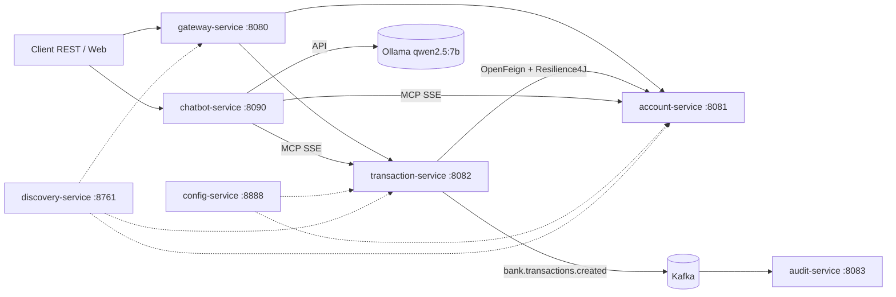

- Les contrôleurs **REST**, **GraphQL** et **MCP** appellent la **même couche `service`**.
- `transaction-service` interroge `account-service` via **OpenFeign** (lecture du solde, mise à jour après enregistrement), protégé par un **circuit breaker Resilience4J** avec fallback.
- Après persistance d'une transaction, un événement est publié sur Kafka, avec `accountId` comme clé.

## 2. Stack technique

| Domaine | Technologie |
|---|---|
| Langage / build | Java 21, Maven multi-modules |
| Framework | Spring Boot, Spring Cloud |
| Découverte / config / gateway | Eureka, Spring Cloud Config, Spring Cloud Gateway |
| Inter-services | OpenFeign, Resilience4J |
| API | REST, GraphQL, MCP (Spring AI MCP Server) |
| IA conversationnelle | Spring AI, Ollama (`qwen2.5:7b`) |
| Messagerie | Apache Kafka 3.9 |
| Machine learning | Python, scikit-learn |
| Conteneurs | Docker, Docker Compose |
| CI/CD | GitHub Actions, GitHub Container Registry (GHCR) |

## 3. Structure du projet

```
.
├── Account-Service/        # comptes bancaires
├── Transaction-Service/    # transactions, virements, publication Kafka
├── audit-service/          # consumer Kafka (journalisation)
├── config-service/         # configuration centralisée
├── discovery-service/      # Eureka
├── gateway-service/        # Spring Cloud Gateway
├── chatbot-service/        # agent IA (Spring AI + MCP)
├── fraud-detection/        # notebook Python + jeu de données
├── docs/images/            # captures d'écran
├── Dockerfile              # Dockerfile générique (argument MODULE)
├── docker-compose.yml      # exécution locale de toute la plateforme
├── .github/workflows/ci.yml
└── pom.xml                 # POM parent (agrégation des modules)
```

Chaque service métier respecte la séparation des couches : `domain/`, `repository/`, `service/`, `web/rest/`, `web/graphql/`, `mcp/`.

## 4. Micro-services métier

### 4.1 account-service (port 8081)

Modèle : `id: UUID`, `customerReference`, `status: ACTIVE | BLOCKED`, `currency`, `balance: double`.

| Méthode | Endpoint | Rôle |
|---|---|---|
| POST | `/api/accounts` | Créer un compte |
| GET | `/api/accounts` | Lister les comptes |
| GET | `/api/accounts/{id}` | Consulter un compte |
| PATCH | `/api/accounts/{id}/status` | Activer / bloquer |
| POST | `/api/accounts/{id}/debit` · `/credit` | Mettre à jour le solde |

GraphQL : endpoint `/graphql`, interface GraphiQL `http://localhost:8081/graphiql?path=/graphql`. Opérations : `accounts`, `accountById`, `createAccount`, `updateAccountStatus`.

### 4.2 transaction-service (port 8082)

Modèle : `id: UUID`, `accountId`, `amount: BigDecimal`, `currency`, `merchantCategory`, `country`, `createdAt: Instant`.

| Méthode | Endpoint | Rôle |
|---|---|---|
| POST | `/api/transactions` | Enregistrer une transaction |
| POST | `/api/transactions/transfer` | Effectuer un virement |
| GET | `/api/transactions` | Lister (filtre possible par compte) |
| GET | `/api/transactions/{id}` | Consulter une transaction |

GraphQL : endpoint `/graphql`, interface GraphiQL `http://localhost:8082/transaction/graphiql?path=/graphql`. Opérations : `transactions`, `transactionById`, `createTransaction`, `transfer`.

**Règles métier appliquées**

- Montant strictement positif et inférieur ou égal au plafond `bank.transaction.max-amount` (**1000**, fourni par le config-service) → sinon `400`.
- Le compte doit exister et être `ACTIVE`.
- La devise de la transaction doit correspondre à celle du compte → sinon `400`.
- Le solde est consulté avant chaque transaction, puis mis à jour après enregistrement.
- Virement possible d'un compte vers un autre.

**Tolérance aux pannes** : l'appel à `account-service` passe par OpenFeign avec un **circuit breaker Resilience4J** (fenêtre glissante de 6 appels, seuil d'échec de 50 %, 10 s en état ouvert). Quand account-service est indisponible, un **fallback** renvoie `503 Service Unavailable` avec un message explicite ; une fois le circuit ouvert, les appels sont rejetés immédiatement (`CallNotPermittedException`).

### 4.3 Serveurs MCP

Chaque service expose ses opérations comme outils MCP (SSE), appelables par le chatbot.

| Service | Outils |
|---|---|
| account-service | lister les comptes, consulter un compte, créer un compte, activer / bloquer un compte |
| transaction-service | lister les transactions, enregistrer une transaction, effectuer un virement |

## 5. Micro-services techniques

| Service | Port | Rôle |
|---|---|---|
| config-service | 8888 | Partage `bank.transaction.max-amount=1000` |
| discovery-service | 8761 | Registre Eureka |
| gateway-service | 8080 | Point d'entrée unique, routage `lb://` vers account et transaction |

## 6. Chatbot agentique

`chatbot-service` (port 8090) utilise **Spring AI** avec un `ChatClient` qui :

- reçoit un prompt système (assistant bancaire, ne jamais inventer d'identifiant, solde ou montant, demander l'UUID s'il manque, répondre en français) ;
- enregistre comme outils les `ToolCallbackProvider` issus des **serveurs MCP** d'account-service et de transaction-service ;
- appelle le modèle local **`qwen2.5:7b`** via Ollama (température 0).

```http
POST http://localhost:8090/api/chat
Content-Type: application/json

{"message": "Liste les comptes bancaires"}
```

Réponse : `{"reply": "..."}`.

> Le modèle tourne sur CPU : la première requête avec outils peut prendre 1 à 3 minutes (chargement du modèle), les suivantes sont plus rapides.

## 7. Communication asynchrone Kafka

- Topic : `bank.transactions.created` (3 partitions).
- Clé du message : `accountId`.
- Publication **après persistance réussie** de la transaction.
- `audit-service` consomme le topic et **journalise** l'événement, sans modifier les données bancaires.

```json
{
  "eventId": "UUID",
  "eventType": "TransactionCreated",
  "transactionId": "UUID",
  "accountId": "UUID",
  "amount": 250.00,
  "currency": "EUR",
  "occurredAt": "2026-01-15T10:30:00Z"
}
```

## 8. Détection de fraude (Python)

Notebook : [`fraud-detection/fraud_detection.ipynb`](fraud-detection/fraud_detection.ipynb) (version HTML : `fraud_detection.html`). Jeu de données : `bank_transactions.csv`, 5 000 transactions.

**Démarche**
- Fraudes : **5,14 %** (257 sur 5 000). Valeurs manquantes : `country` (66), `merchant_category` (84), `average_amount_last_7d` (75).
- Séparation **stratifiée** 80/20 ; identifiants (`transaction_id`, `account_id`) exclus des variables explicatives.
- Pipeline : imputation (médiane / modalité la plus fréquente), one-hot, normalisation, **ajusté uniquement sur l'entraînement**.
- Choix du modèle (régression logistique contre random forest) et du **seuil** par validation croisée sur l'entraînement ; le test n'est utilisé qu'une fois.

**Résultats sur le test** (seuil ≈ 0,78) : précision de la classe fraude ≈ 0,21, rappel ≈ 0,20, F1 ≈ 0,20, average precision ≈ 0,19, soit environ quatre fois le hasard (5 %).
Le signal contenu dans ces variables est faible : les fraudes se distinguent par des montants élevés relativement à la moyenne sur 7 jours, une forte activité sur 24 h et la nuit, sans séparation nette. Le notebook détaille les limites et les pistes d'amélioration, et répond aux 4 questions d'analyse (insuffisance de l'accuracy, compromis faux positifs / fraudes manquées, effet du seuil, validation temporelle).

## 9. Docker et Docker Compose

Un **Dockerfile unique** (build multi-étapes) construit n'importe quel module grâce à l'argument `MODULE` :

```bash
docker build --build-arg MODULE=Account-Service -t bank/account-service .
```

`docker-compose.yml` démarre Kafka (listeners interne `kafka:29092` et externe `localhost:9092`), le config-service, Eureka, les services métier, l'audit, le gateway et le chatbot. Les URLs `localhost` des fichiers de configuration sont remplacées par des noms de service via des variables d'environnement (`SPRING_CONFIG_IMPORT`, `EUREKA_CLIENT_SERVICEURL_DEFAULTZONE`, `SPRING_KAFKA_BOOTSTRAP_SERVERS`, `SPRING_AI_MCP_CLIENT_SSE_CONNECTIONS_*`, `SPRING_AI_OLLAMA_BASE_URL`). Config-service et discovery-service ont un healthcheck, et les autres services attendent qu'ils soient `healthy`.

## 10. CI/CD GitHub Actions

Pipeline `.github/workflows/ci.yml`, trois jobs :

1. **build-test** : compilation et tests Maven (`mvn -B verify`).
2. **docker** : construction des 7 images (matrice) et publication dans GHCR, sur `main`.
3. **deploy** : étape de déploiement schématique (`docker compose pull && docker compose up -d`).

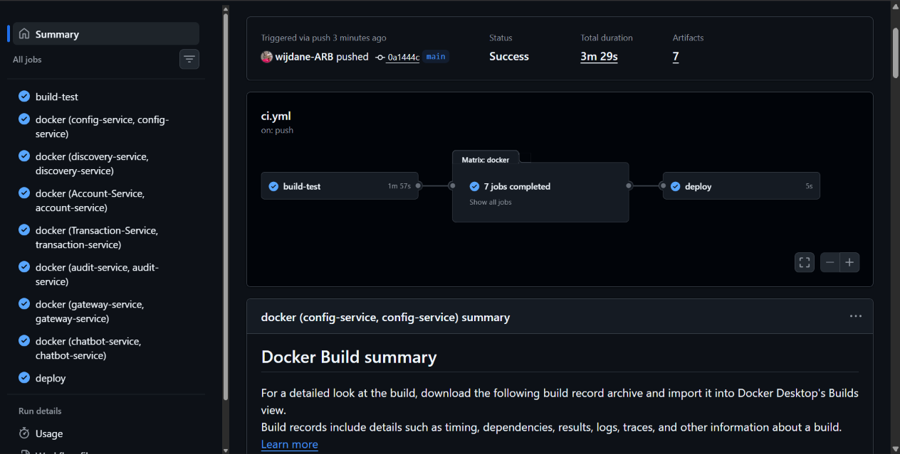
*Run complet réussi : build-test, 7 images Docker, deploy.*

## 11. Lancer le projet

**Prérequis** : Docker Desktop, Ollama avec le modèle `qwen2.5:7b`.

```bash
ollama pull qwen2.5:7b
docker compose up -d
docker compose ps
```

Les services mettent environ une minute à démarrer. Pour arrêter : `docker compose down`.

> Les bases H2 sont **en mémoire** : redémarrer un conteneur vide ses données.

| Accès | URL |
|---|---|
| Eureka | http://localhost:8761 |
| Gateway | http://localhost:8080 |
| GraphiQL comptes | http://localhost:8081/graphiql?path=/graphql |
| GraphiQL transactions | http://localhost:8082/transaction/graphiql?path=/graphql |
| Chatbot | `POST http://localhost:8090/api/chat` |

## 12. Tests et captures d'écran

### Conteneurs en fonctionnement

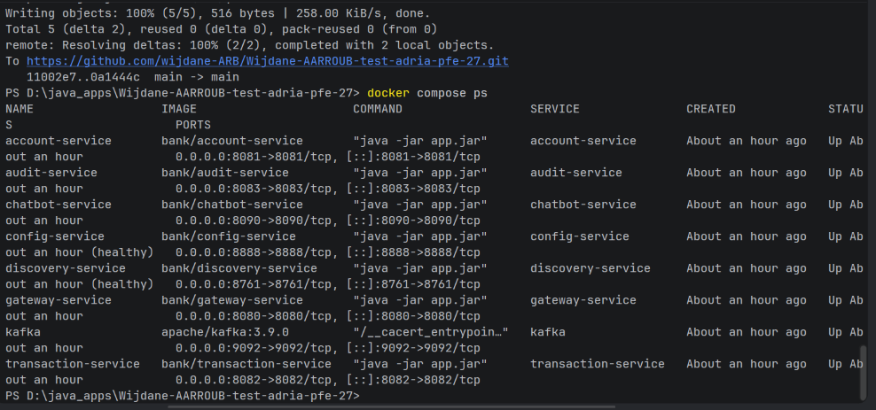

### Découverte de services (Eureka)

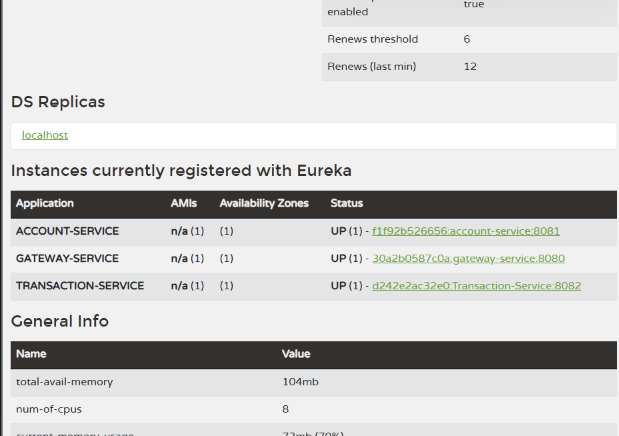
*ACCOUNT-SERVICE, GATEWAY-SERVICE et TRANSACTION-SERVICE enregistrés et `UP`.*

### REST — création d'un compte

Direct sur account-service (`:8081`) :

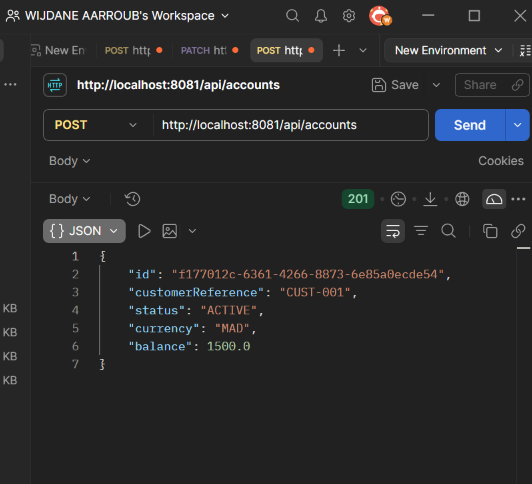

Via la gateway (`:8080`) :

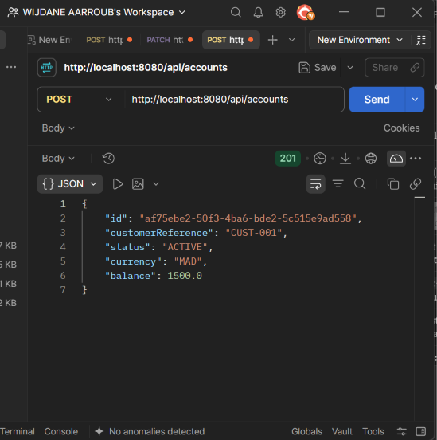

### GraphQL

Création d'un compte :

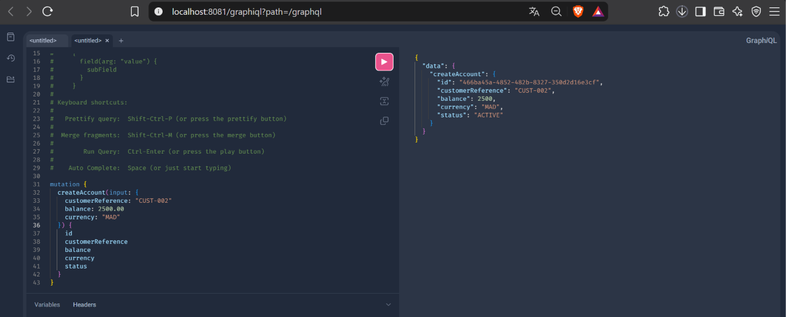

Blocage d'un compte (`updateAccountStatus`) :

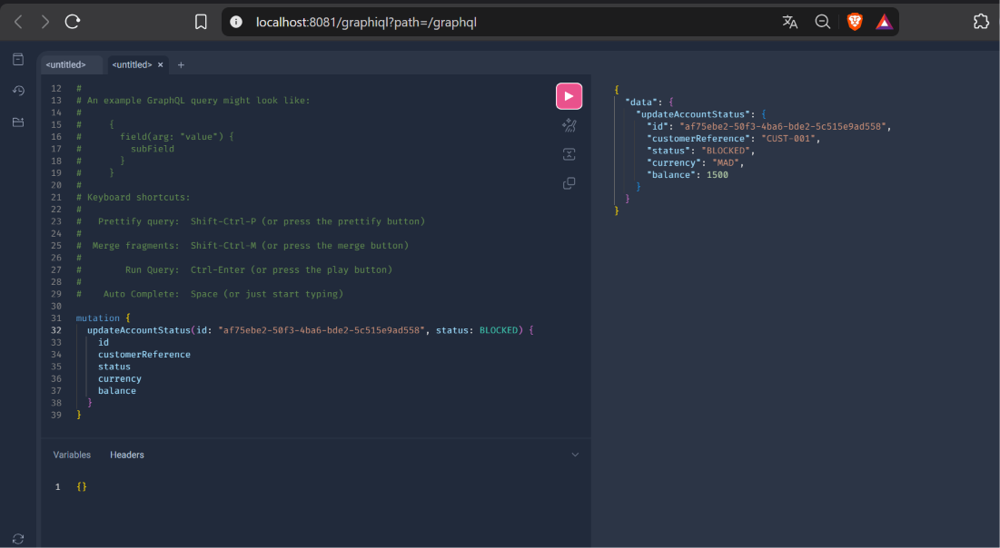

### Transaction valide (REST via gateway)

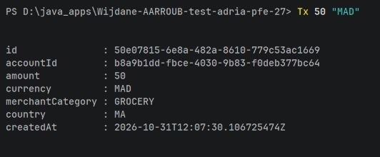

### Règles métier

Montant supérieur au plafond (1000) et devise différente de celle du compte : `400 Bad Request` avec un message explicite.

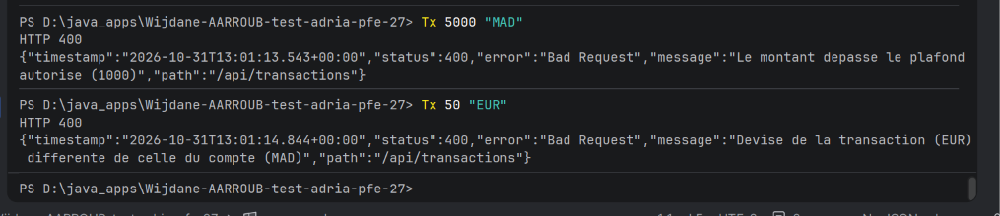

<!-- Compte bloqué : à ajouter

-->

### Résilience — circuit breaker (Resilience4J)

`account-service` arrêté : `503 Service Unavailable` puis `CallNotPermittedException` (circuit ouvert), réponses immédiates.

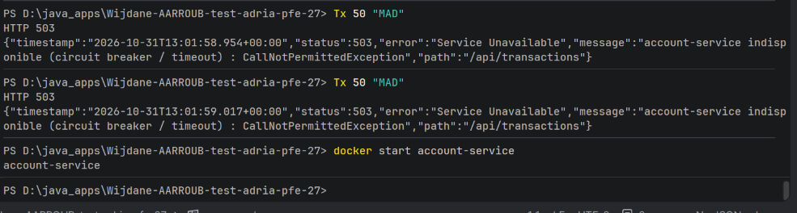

### Chatbot agentique

Consultation des comptes via les outils MCP :

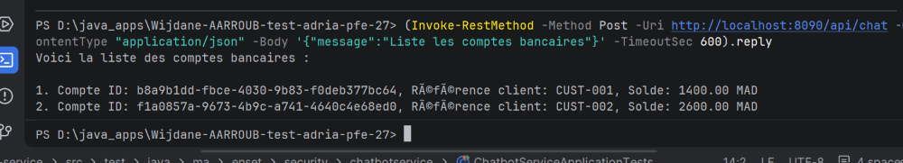

Virement en langage naturel, puis vérification des soldes (−100 MAD / +100 MAD) :

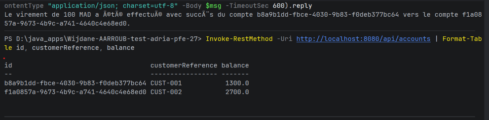

### Kafka — événements journalisés par audit-service

Événements `TransactionCreated`, clé `accountId`, topic `bank.transactions.created` :

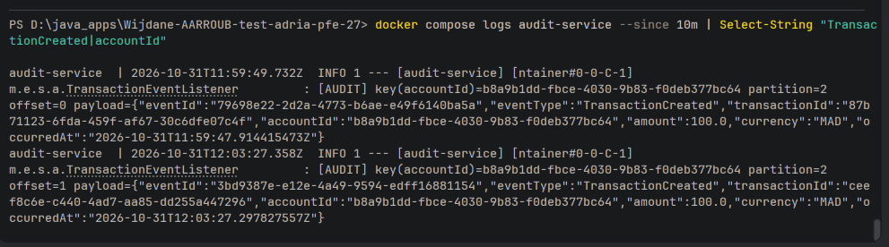

## 13. DevOps : réponses courtes

**Secrets et configuration.** La configuration (URLs, plafonds, ports) n'est pas confidentielle et vit dans le config-service ou les variables d'environnement. Les secrets (mots de passe, jetons, clés API) ne sont jamais commités : ils sont injectés à l'exécution via les *secrets* GitHub Actions, Docker/Kubernetes secrets ou un coffre (Vault), puis lus comme variables d'environnement.

**Contrôles de santé.** Avec Spring Boot Actuator : *startup* (l'application a fini de démarrer), *readiness* (`/actuator/health/readiness`, prête à recevoir du trafic : dépendances disponibles) et *liveness* (`/actuator/health/liveness`, le processus répond ; sinon redémarrage). Les healthchecks du Compose s'appuient sur `/actuator/health`.

**Logs, métriques, traces.** Logs structurés (JSON) centralisés (ELK ou Loki) ; métriques Micrometer exposées à Prometheus et visualisées dans Grafana ; traces distribuées avec Micrometer Tracing / OpenTelemetry vers Zipkin ou Jaeger, avec un identifiant de corrélation propagé entre services.

**Rollback.** Les images sont taguées par SHA de commit : le retour arrière consiste à redéployer le tag précédent (`docker compose up -d` avec l'ancienne version, ou `kubectl rollout undo`). Un déploiement progressif (canary / blue-green) et les probes de readiness limitent l'impact d'une mauvaise version.

## 14. État d'avancement

| Partie | Contenu | État |
|---|---|---|
| C | Account, Transaction, OpenFeign, Resilience4J (REST, GraphQL, MCP) | ✅ |
| D | Gateway, Eureka, Config | ✅ |
| E | Chatbot agentique (Spring AI, MCP, Ollama) | ✅ |
| F | Kafka (producer, consumer d'audit) | ✅ |
| H | Détection de fraude (notebook Python) | ✅ |
| I | Dockerfile, Compose, GitHub Actions, réponses courtes | ✅ |
| B | Diagrammes de classes et d'architecture | ✅ |
| G | Client web (Angular / React) | ⏳ |
